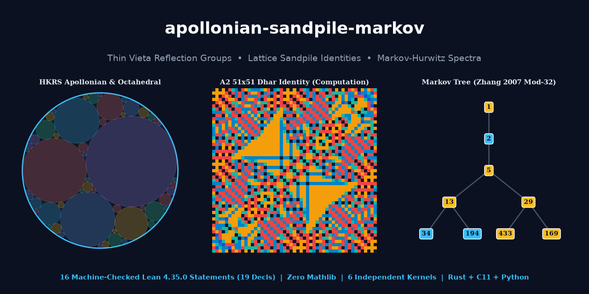

<!-- SPDX-License-Identifier: CC-BY-4.0 -->
# Apollonian–Sandpile–Markov (`0TH-2026-018`)

**Thin Vieta Reflection Groups, Apollonian–Octahedral Reciprocity Obstructions, Integer-Superharmonic Sandpile Envelopes, and Markov–Hurwitz Geodesic Spectra: A Zero-Mathlib Six-Kernel Formalization.**

[](https://github.com/0thernes/apollonian-sandpile-markov/actions/workflows/ci.yml)
[](https://0thernes.github.io/apollonian-sandpile-markov/)
[](lean/lean-toolchain)
[](VERIFICATION.md)
[](LICENSE-CODE)
[](LICENSE)
[](https://orcid.org/0009-0006-8168-9648)



- **Author:** Alexander Stephen Donahue (Independent Researcher, Spokane, WA, USA · ORCID `0009-0006-8168-9648`)
- **Archive ID:** `0TH-2026-018` (registered in [0thernes-research-archive](https://github.com/0thernes/0thernes-research-archive))
- **Live Interactive Observatory:** [https://0thernes.github.io/apollonian-sandpile-markov/studio/](https://0thernes.github.io/apollonian-sandpile-markov/studio/)
- **Live Lean 4 Proof Blueprint:** [https://0thernes.github.io/apollonian-sandpile-markov/blueprint/](https://0thernes.github.io/apollonian-sandpile-markov/blueprint/)
- **Frozen AMS-LaTeX White Paper:** [dist/Donahue_2026_apollonian_sandpile_markov.pdf](dist/Donahue_2026_apollonian_sandpile_markov.pdf)

---

## Summary

This repository contains a zero-Mathlib Lean 4.35.0 development with 15 headline statements (`T1a`–`T3e`), a master conjunction, non-vacuity witnesses and six false-variant refutations, together with Rust, ISO C11 and Python programs that recompute the finite data.

Most of the 15 statements are formalizations of known results: the Haag–Kertzer–Rickards–Stange square obstruction for three specific Apollonian packings, Ying Zhang's 2007 theorem that every even Markov number is 2 mod 32, the classical Hurwitz `n = 4` coefficient classification, and the Abelian sandpile toppling laws (Dhar 1990). The others are finite computations, elementary identities, and one elementary parity lemma on the triangular lattice (`T2d`) for which no prior statement was found. No open problem is solved, and no theorem here is a bounded case of `STAT-058` or `NT-083`; those links are thematic only.

**What is checked and how.** The built Lean modules contain no `sorry`, `admit` or `native_decide`. The file `lean/PalomarChallenge.lean` holds 16 intentional `by sorry` stubs: it is the comparator challenge and is not a build target. All 18 audited declarations depend only on `[propext, Classical.choice, Quot.sound]` (block below). The Ubuntu CI job runs `lake build` and the axiom audit; replays the `Solution` and `PalomarSolution` modules with `leanchecker` and `leanchecker-paranoid` (lean4lean); checks an export of three root declarations (the master conjunction, `NonVacuity.nonvac_all_hypotheses`, `Adversarial.all_adversarial_refutations`) and their dependency closure with `nanoda_bin`, `con-leche` and `con-ron`; and runs `lake comparator --paranoid` on the 16 targets listed in `lean/comparator.json`. The 2026-11-26 statement audit rebuilt the project and re-ran the axiom audit; it did not re-run the six-kernel replay locally (CI run 45849166650 passed at commit `0cf60c5`). CI also runs differential tests between the Rust, C11 and Python programs and a Python mutation harness (8 of 8 mutants killed in the release run).

### What the Lean statements say

1. **Reflection groups and packings (`T1a`–`T1e`):**
   - `T1a`: The four Apollonian reflections are involutions preserving the Descartes form; for Descartes quadruples `(a+b)(a+c) = a^2 + k^2`; a two-square product identity for the associated binary quadratic form. Classical algebra, used as a lemma for `T1c`.
   - `T1b`: A Jacobi symbol built from Euler's criterion, with the `(-1/n)` and `(2/n)` laws, reciprocity for coprime odd `m, n ≥ 1`, multiplicativity, and `(a^2/n) = 1` for `gcd(a,n) = 1`. Classical; the proof follows Eisenstein's 1844 lattice-point argument.
   - `T1c`: In the packings generated by `(-3,5,8,8)`, `(-7,17,12,20)` and `(-11,21,24,28)` (every quadruple reachable by the four reflections), no curvature equals `m^2` for any integer `m`. This formalizes, for these three packings, the square obstruction of Haag, Kertzer, Rickards and Stange (*Ann. of Math.* 200 (2024), arXiv:2307.02749; Theorem 1.6 for `(-3,5,8,8)`, Table A for the other two); only the zero-Mathlib proof route is new. The contrast root `(-4,8,9,9)` is shown in Lean to have Descartes form 0 and to contain the square 9. Its mod-24 curvature set `{0,8,9,12,17,20}` equals that of `(-7,17,12,20)` (a computation, not a Lean statement). It is not an unobstructed packing: HKRS list quadratic obstructions `3n^2`, `6n^2` and quartic obstructions `n^4`, `4n^4` for it.
   - `T1d`: Eight octahedral reflections are involutions preserving the octahedral equations, and a `sqrt(-2)` norm identity holds. Every sextuple reachable from `(-6,10,17,40,24,17)` has residues `(2,2,1,0,0,1)` mod 8, so `b1, b2` are never squares and `b3, b6` are never twice a square. This is a mod-8 congruence argument. The five Jacobi symbol values in the statement are closed evaluations not linked to the orbit, and no reciprocity argument is formalized. The strip `(0,0,1,2,2,1)` is the contrast. Quadratic reciprocity obstructions for octahedral packings were given earlier by Shi, Shi, Whitehead, Williams-Tracy and Zhang (arXiv:2510.21702, 2025).
   - `T1e`: For natural `d ≥ 2`, `(d - 1) ∣ 2 ↔ d = 2 ∨ d = 3` (an arithmetic fact; Lean does not link it to `d`-dimensional Soddy reflections). Five 3D Soddy reflections are involutions, the first preserves the Soddy form, and one reflection of `(-6,13,13,13,18)` produces `25 = 5^2`.
2. **Sandpiles and lattice Laplacians (`T2a`–`T2e`):**
   - `T2a`: For symmetric zero-diagonal adjacency with arbitrary degrees, topplings commute; any legal trace fires each vertex at most `w` times for a stabilizing odometer `w` (least action bound); two legal stabilizing traces have equal firing counts and equal results. No sink condition and no termination theorem are formalized. The Abelian property is due to Dhar (1990) and the least action principle is a known result.
   - `T2b`: `det(L_{2×2}) = 192` for the 2×2 grid Dirichlet Laplacian. For the 3×3 grid, Lean proves an integer similarity `Q * Qinv = 4I`, `L * Q = Q * D` with `D` block diagonal, and `4 * det(B2)^2 * det(B4) = 100,352`. The 9×9 determinant itself and any Matrix–Tree or sandpile-group-order link are not formalized. Explicit legal toppling traces reach `[2,2,2,2]` and `[2,1,2,1,0,1,2,1,2]`; Lean does not prove these are the group identities. The A2 determinants 1,092 and 5,393,920 are Rust/Python computations only.
   - `T2c`: No integer `u` on `Z^2` with `4u = 3(x^2+y^2) + ψ`, `ψ` doubly periodic, has square-lattice Laplacian `≤ 3` everywhere; four explicit functions have constant Laplacian 2 or 3. The proof uses an internal torus summation lemma. This is one isotropic case, not the Levine–Pegden–Smart classification; whether it already appears in Levine–Pegden–Smart (*Ann. of Math.* 2017) was not checked.
   - `T2d` (elementary parity lemma, no prior statement found): Let `M ≥ 1`, `ψ` doubly periodic, and `u : Z^2 → Z` with `M*u = A*x^2 + B*x*y + C*y^2 + D*x + E*y + ψ`. If `M*K = 4A - 2B + 4C` and the six-neighbour triangular-lattice Laplacian of `u` is `≤ K` everywhere, then `K` is even; so `K = 5` is impossible in this class, while `K = 4` and `K = 2` are attained. The hypotheses force a constant Laplacian, and integer-valued quadratics have even A2 Laplacian, so the argument is short. The lemma says nothing about sandpile configurations of height 5 or about the A2 sandpile identity.
   - `T2e`: A lattice-polygon edge-normal closure identity `∑ R_{90°}(v_{i+1} - v_i) = (0,0)`, the identity `det(v1,v2) = det(v2,v3) = det(v3,v1)` when `v1 + v2 + v3 = 0`, and a few closed numeric checks. The Kalinin–Shkolnikov theorem is not formalized; the declaration name `t2e_kalinin_shkolnikov_...` is descriptive only.
3. **Markov–Hurwitz equations and cluster mutations (`T3a`–`T3e`):**
   - `T3a`: The Fricke trace identity for 2×2 integer matrices of determinant 1, and at every node of the Cohn tree from `((1,1,1,2),(1,2,2,5))`: determinant 1, `tr[A,B] = -2`, and the integer quotients `tr/3` satisfy the Markov equation. The exported statement uses integer division by 3 without stating `3 ∣ tr` (the internal lemma has it). Classical (Fricke; Cohn 1955).
   - `T3b`: For triples reachable from `(1,1,1)` by Vieta moves: positive, Markov, pairwise coprime; odd primes dividing the first entry are 1 mod 4; an odd first entry is 1 mod 4; an even first entry is 2 mod 32; `(2,1,1)` and `(34,13,1)` occur, so the residue mod 64 is not fixed. The mod-32 statement and these witnesses are Ying Zhang's theorem (*Congruence and uniqueness of certain Markoff numbers*, Acta Arith. 128 (2007) 295–301, arXiv:math/0612620); this repository gives a zero-Mathlib formalization of it. That every positive Markov triple lies in the tree (Markov's theorem) is not formalized.
   - `T3c`: For an odd prime `p` and `k ≥ 1`, if `p^k` divides `r1^2 + 1` and `r2^2 + 1` then `p^k` divides `r1 - r2` or `r1 + r2`. Standard elementary number theory.
   - `T3d`: Exchange identities along one five-step mutation sequence of the Markov quiver: `P1*P4 = x1^4 x2^2 x3^2 P2^2 + P3^2` and `P2*P5 = x1^6 x2^4 x3^2 P3^2 + P4^2` for explicit subtraction-free polynomials, including divisions by the non-monomial `P1 = x2^2 + x3^2` and `P2 = P1^2 + x1^2 x3^2`; values at `(1,1,1)` are `2, 5, 29, 433, 37666`. Lean states positivity of values at positive integers; coefficient positivity holds by inspection of the definitions but is not a stated theorem. This is a finite instance of the Laurent phenomenon (Fomin–Zelevinsky 2002) and of positivity (Lee–Schiffler 2015).
   - `T3e`: Positive integer solutions of `x1^2 + x2^2 + x3^2 + x4^2 = a*x1*x2*x3*x4` exist only for `a = 1` (all `x_i ≡ 2 mod 4`) or `a = 4` (all `x_i` odd); there are none for `a ∈ {2,3}` or `a ≥ 5`; explicit solutions are given. This is the classical classification of admissible coefficients (Hurwitz, 1907). The description of all solutions as Vieta orbits is not part of the exported statement.

`NonVacuity.lean` gives witnesses for theorem premises, but not a joint witness for every theorem (none for the `T2d` hypothesis bundle or for `IsStabilizingOdometer`). `Adversarial.lean` gives six refutations of false variants; one of them (`adv6`) is a corollary of `T3e`, and they do not show that every hypothesis is needed.

---

## 5-Second Axiom Certificate (`results/lean_axioms.txt`, Verbatim)

Verified by `scripts/check_readme_axioms.py` against the output of `lake env lean VerifyAxioms.lean` (also diffed in CI):

```text
'ApollonianSandpileMarkov.Palomar.t1a_descartes_lorentzian_and_gaussian_norm' depends on axioms: [propext,
 Classical.choice,
 Quot.sound]
'ApollonianSandpileMarkov.Palomar.t1b_jacobi_reciprocity_master' depends on axioms: [propext,
 Classical.choice,
 Quot.sound]
'ApollonianSandpileMarkov.Palomar.t1c_hkrs_apollonian_reciprocity_obstruction' depends on axioms: [propext,
 Classical.choice,
 Quot.sound]
'ApollonianSandpileMarkov.Palomar.t1d_octahedral_lorentzian_and_sqrt_neg2_obstruction' depends on axioms: [propext,
 Classical.choice,
 Quot.sound]
'ApollonianSandpileMarkov.Palomar.t1e_soddy_dimension_dichotomy_and_3d_contrast' depends on axioms: [propext,
 Classical.choice,
 Quot.sound]
'ApollonianSandpileMarkov.Palomar.t2a_abelian_sandpile_confluence_and_least_action' depends on axioms: [propext,
 Classical.choice,
 Quot.sound]
'ApollonianSandpileMarkov.Palomar.t2b_dhar_critical_identity_and_grid_orders' depends on axioms: [propext, Quot.sound]
'ApollonianSandpileMarkov.Palomar.t2c_lps_z2_superharmonic_and_isotropic_obstruction' depends on axioms: [propext,
 Classical.choice,
 Quot.sound]
'ApollonianSandpileMarkov.Palomar.t2d_triangular_a2_even_laplacian_rigidity_and_obstruction' depends on axioms: [propext,
 Classical.choice,
 Quot.sound]
'ApollonianSandpileMarkov.Palomar.t2e_kalinin_shkolnikov_tropical_balancing_and_solitons' depends on axioms: [propext,
 Classical.choice,
 Quot.sound]
'ApollonianSandpileMarkov.Palomar.t3a_sl2z_fricke_cohn_markov_correspondence' depends on axioms: [propext,
 Classical.choice,
 Quot.sound]
'ApollonianSandpileMarkov.Palomar.t3b_markov_coprimality_odd_primes_and_mod32' depends on axioms: [propext,
 Classical.choice,
 Quot.sound]
'ApollonianSandpileMarkov.Palomar.t3c_hensel_sqrt_neg1_prime_power_uniqueness' depends on axioms: [propext,
 Classical.choice,
 Quot.sound]
'ApollonianSandpileMarkov.Palomar.t3d_cluster_algebra_markov_laurent_positivity' depends on axioms: [propext,
 Classical.choice,
 Quot.sound]
'ApollonianSandpileMarkov.Palomar.t3e_markov_hurwitz_n4_complete_classification' depends on axioms: [propext,
 Classical.choice,
 Quot.sound]
'ApollonianSandpileMarkov.Palomar.prove_all_apollonian_sandpile_markov_theorems' depends on axioms: [propext,
 Classical.choice,
 Quot.sound]
'ApollonianSandpileMarkov.NonVacuity.nonvac_all_hypotheses' depends on axioms: [propext, Classical.choice, Quot.sound]
'ApollonianSandpileMarkov.Adversarial.all_adversarial_refutations' depends on axioms: [propext,
 Classical.choice,
 Quot.sound]
```

---

## Quickstart & One-Command Reproduction

```bash
# 1. Offline Python quickstart exercising all three pillars
PYTHONPATH=python python examples/quickstart_demo.py

# 2. Zero-dependency Rust core tests & JSON summary
(cd rust && cargo test --release && cargo run --release -- --json ../results/rust_summary.json)

# 3. Independent ISO C11 verifier + 100k fuzzer (Linux/macOS with gcc/clang)
gcc -std=c11 -O2 -Wall -Wextra -Werror -fsanitize=address,undefined native/asm_verify.c -o native/asm_verify && ./native/asm_verify
gcc -std=c11 -O2 -Wall -Wextra -Werror -fsanitize=address,undefined native/fuzz_asm.c -o native/fuzz_asm && ./native/fuzz_asm

# 4. Python exact oracle, Hypothesis property suite, differential tests & mutation suite
PYTHONPATH=python pytest -v tests/test_all.py
PYTHONPATH=python python scripts/mutate.py

# 5. Zero-Mathlib Lean 4.35.0 build, axiom audit & leanchecker
(cd lean && lake build && lake env lean VerifyAxioms.lean && lake env leanchecker Solution && lake env leanchecker PalomarSolution)

# 6. Full repo hygiene, verbatim axioms, and citation verification
python scripts/check_readme_axioms.py && python scripts/check_citations.py --offline && python scripts/audit_repo.py
```

Or run `just all` via [`justfile`](justfile).

---

## Scope and Open Problems

The 15 statements are kernel-checked as written; their exact scope is given above and in [`CLAIMS.md`](CLAIMS.md). Corrections from the 2026-11-26 statement audit are listed in [`ERRATA.md`](ERRATA.md). The following problems remain open and are not addressed by any theorem here (see [`LIMITATIONS.md`](LIMITATIONS.md)):
- Classification of reciprocity obstructions across all primitive Apollonian and generalized circle or sphere packings;
- The continuum scaling limit of the $\mathbb{Z}^2$ or $\mathbb{A}_2$ sandpile identity (`STAT-058`), and the description of integer superharmonic matrices on $\mathbb{A}_2$;
- The Markov uniqueness conjecture (`NT-083`);
- A formalization of all-depth cluster positivity (proved by Lee–Schiffler 2015) and of Hurwitz equations for $n \ge 5$.

---

## Maintenance & Licensing

- **Status:** Actively maintained v1.0.0 archival research release. Report findings via GitHub Issues (10-class Build Standard taxonomy).
- **Dual License:** All software, Lean 4 proofs, Rust/C11/Python code, scripts, and studio HTML/JS are licensed under **Apache-2.0** ([`LICENSE-CODE`](LICENSE-CODE)). All prose, white paper, figures, documentation, and verified datasets are licensed under **CC-BY-4.0** ([`LICENSE`](LICENSE)).
